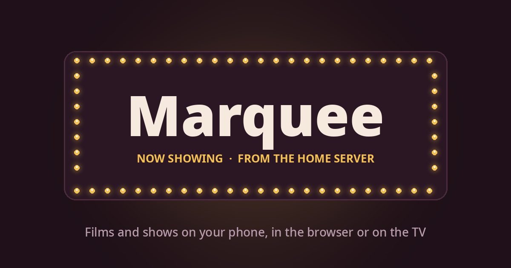

# Marquee

[](https://github.com/Tjabooo/marquee/actions/workflows/ci.yml)
[](https://github.com/Tjabooo/marquee/releases)
[](https://github.com/Tjabooo/marquee/pkgs/container/marquee)



A self-hosted media server for your home, made for phones first. Find a film or show, press
Download, and watch it in the browser, on your phone or on the TV, with subtitles that fit.

Marquee is one Node.js process with no npm dependencies. It runs on Windows, Linux, macOS and in
Docker, and installs as a web app on your phone's home screen.

## Features

- **Discover and search** with posters and details from TMDB; titles already on the server are marked.
- **One-press downloads** through qBittorrent: films pick a suitable release, shows download a season
  in episode order and skip what you already have. Torrent search covers The Pirate Bay and 1337x.
- **Plays everywhere**: automatic MP4 copies for iPhone and Apple TV, browser-safe audio for Dolby/DTS,
  H.264 copies of HEVC for Firefox, timeline previews, Up next with credits detection.
- **Subtitles** from OpenSubtitles, with their timing checked and fixed against the audio.
- **Casting** to DLNA smart TVs and Apple TV, with a full-screen remote.
- **Watch Together** rooms with synced playback.
- **Personal accounts** through Cloudflare Access: everyone gets their own library, progress and
  settings; files exist once on disk and auto-delete when nobody keeps them.
- **For the owner**: Activity, a House dashboard for the server and home machines, game Clips with
  share links and a lossless trimmer (`node setup.js clipper` installs
  [Clipper](https://github.com/Tjabooo/clipper) to record them), and a shared Notes inbox with image
  text search.

Details: [docs/features.md](docs/features.md).

## Requirements

- **Node.js 22.16 or later** (uses the built-in `node:sqlite` with FTS5)
- Optional: **ffmpeg** (conversion, subtitle timing, previews), **qBittorrent** with Web UI (downloads),
  a **TMDB** token (search and posters), an **OpenSubtitles** API key, **pyatv** (Apple TV),
  **Tesseract** (Notes image search outside Windows)

Anything you don't set up is simply off, so you can start small.

## Quick start

```sh
git clone --branch v1.1.0 https://github.com/Tjabooo/marquee.git
cd marquee
node setup.js
```

`setup.js` detects your system, asks only what it can't work out, writes `.env`, checks your
integrations and can register Marquee to start at boot. Open the address it prints. It's safe to
run again at any time; `node setup.js doctor` checks an installation without changing anything.

Prefer an installer? It downloads a release, verifies its checksum, and keeps updates separate from
your settings and data (read it first: [install.sh](install.sh), [install.ps1](install.ps1)):

```sh
curl -fsSLO https://raw.githubusercontent.com/Tjabooo/marquee/v1.1.0/install.sh && sh install.sh
```

```powershell
irm https://raw.githubusercontent.com/Tjabooo/marquee/v1.1.0/install.ps1 -OutFile install.ps1; powershell -ExecutionPolicy Bypass -File install.ps1
```

## Docker

```sh
curl -fsSLO https://raw.githubusercontent.com/Tjabooo/marquee/v1.1.0/docker-compose.yml
curl -fsSL https://raw.githubusercontent.com/Tjabooo/marquee/v1.1.0/.env.example -o marquee.env   # add your tokens
MEDIA_PATH=/srv/media docker compose up -d
```

Images for `linux/amd64` and `linux/arm64` are published as `ghcr.io/tjabooo/marquee`. Optional
Compose profiles add qBittorrent, qBittorrent behind a VPN (Gluetun) and FlareSolverr. See
[docs/install/docker.md](docs/install/docker.md).

## Configuration

Settings live in `.env` (or the container environment). The ones most people set:

| Setting | Purpose |
| --- | --- |
| `MEDIA_DIR` | Folder with your films and shows |
| `TMDB_TOKEN` | Search, posters and episode details |
| `QBIT_URL`, `QBIT_USER`, `QBIT_PASS` | Downloads through qBittorrent |
| `OPENSUBTITLES_API_KEY` | Subtitles |
| `ADMIN_EMAILS` | Owner accounts (with Cloudflare Access) |
| `PORT`, `HOST`, `DATA_DIR` | Where it listens and keeps its state |

Every setting: [docs/configuration.md](docs/configuration.md).

## Platforms

Windows 10/11, Debian/Ubuntu, Fedora, Arch, macOS (Intel and Apple silicon), Raspberry Pi 4/5 (64-bit),
Docker, Unraid, Synology, TrueNAS SCALE, Proxmox LXC and WSL2. Guides: [docs/install/](docs/install/README.md).

CI runs the tests and a start-up check on Ubuntu, Windows and macOS with Node.js 22.16 and 24, and
builds and starts the Docker image. The NAS, Raspberry Pi, Proxmox and WSL2 guides follow those
platforms' standard procedures and haven't been verified on that hardware.

## Security model

Marquee has no login screen of its own. On your home network everyone shares one account; personal
accounts come from an authenticating proxy, normally Cloudflare Access. Marquee believes identity
headers only from trusted proxies (by default, this machine) or with a verified Access token.

**Don't expose Marquee's port to the internet.** For remote access use Tailscale, Cloudflare Tunnel
with Access, or a reverse proxy that requires sign-in: [docs/remote-access.md](docs/remote-access.md).
To report a vulnerability, see [SECURITY.md](SECURITY.md).

## Documentation

- [Installation](docs/install/README.md) and [upgrading, backups and rollback](docs/upgrading-and-backups.md)
- [Configuration reference](docs/configuration.md)
- [Integrations](docs/integrations.md): TMDB, qBittorrent, OpenSubtitles, ffmpeg, TVs, House, Clips, Invites
- [Remote access and security](docs/remote-access.md)
- [Hardware acceleration](docs/hardware-acceleration.md)
- [How it works](docs/architecture.md), including the HTTP API
- [Troubleshooting](docs/troubleshooting.md)
- [Changelog](CHANGELOG.md)

## Development

```sh
npm test                       # node --test, no dependencies to install
node server.js                 # run from the checkout
node scripts/ci/smoke.mjs      # setup, start, health check and clean stop in a temp folder
```

The server is plain ES modules in `src/`, the web app plain JavaScript in `public/`; there is no
build step.

## Disclaimer

Marquee is a media management tool. Its torrent search queries third-party sites and does not host,
index or distribute content. Downloading copyrighted material without permission is illegal in many
countries; you are responsible for how you use this software.
